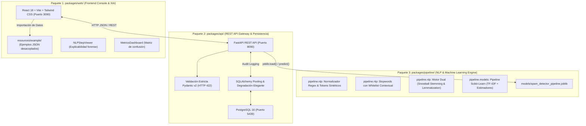

# Arquitectura de Software y Especificación Técnica (ARCHITECTURE.md)

## 1. Organización en Tres Paquetes Desacoplados (Monorepo)

El sistema se estructura bajo una arquitectura modular limpia compuesta por **3 paquetes especializados dentro de `packages/`**, garantizando desacoplamiento estricto de responsabilidades, alta cohesión y testeabilidad independiente:

### Especificación de los 3 Paquetes

1. **`packages/web/` (Paquete Frontend):**
   - Consola visual de ciberseguridad construida en React 18, Vite, TypeScript y Tailwind CSS.
   - Escáner individual, ingesta masiva por lotes CSV, calibración de umbrales (Threshold Tuning 20-80%) y visor forense de explicabilidad paso a paso (`/nlp/debug`).
   - Cero cadenas de texto hardcodeadas: los ejemplos de prueba residen en `resources/example/samples.json`.

2. **`packages/api/` (Paquete Microservicio REST API):**
   - Servicio asíncrono FastAPI con ciclo de vida `lifespan` que mantiene el modelo serializado en memoria para inferencia en `< 5 ms`.
   - Endpoints `/predict`, `/predict/batch/csv`, `/nlp/debug`, `/metrics`, `/health` y `/history`.
   - Persistencia inmutable transaccional en PostgreSQL (puerto 5439) con degradación elegante.

3. **`packages/pipeline/` (Paquete NLP & ML Engine):**
   - **`pipeline.nlp`**: Normalización con tokens sintéticos (`TOKEN_URL`, `TOKEN_TEL`, `TOKEN_NUM`), tokenización boundary-safe, stopwords con whitelist contextual y motor morfológico dual (Snowball Stemming y Lematización canónica en español).
   - **`pipeline.models`**: Entrenamiento determinista, optimización con 5-Fold Stratified Cross-Validation, evaluación con métricas por clase y exportación atómica a `.joblib` y `metrics.json`.
   - Principio de Pipeline Único: el preprocesamiento está encapsulado en `sklearn.pipeline.Pipeline`; el backend nunca reimplementa transformaciones manuales.

## 2. Aislamiento de Red y Puertos de Docker Compose

| Servicio | Contenedor | Host (Local) | Variable de Entorno | Descripción |
| :--- | :---: | :---: | :--- | :--- |
| **frontend** | `80` | **`3090`** | `VITE_API_URL=http://localhost:8090` | Servidor Nginx con compilado estático de React |
| **api** | `8000` | **`8090`** | `DATABASE_URL=postgresql://user:pass@db:5432/spamdb` | API REST asíncrona FastAPI |
| **db** | `5432` | **`5439`** | `POSTGRES_DB=spamdb` | Motor PostgreSQL con volumen `postgres_data` |

## 3. Modelo de Datos Relacional (PostgreSQL)

### Tabla: `message_audits`

- `id`: `INTEGER PRIMARY KEY GENERATED ALWAYS AS IDENTITY`
- `created_at`: `TIMESTAMP WITH TIME ZONE DEFAULT NOW()`
- `message_text`: `TEXT NOT NULL`
- `prediction`: `VARCHAR(10) NOT NULL` (`ham` o `spam`)
- `probability_spam`: `FLOAT NOT NULL`
- `probability_ham`: `FLOAT NOT NULL`
- `risk_level`: `VARCHAR(15) NOT NULL` (`BAJO`, `MEDIO`, `CRÍTICO`)
- `detected_tokens`: `JSONB` (Lista de tokens clave encontrados como `TOKEN_URL`)
- `user_feedback`: `VARCHAR(10) NULL` (Corrección manual: `true_positive`, `false_positive`)

## 4. Invariantes de Seguridad y Rendimiento

1. **Inferencia en Memoria:** La predicción y el pipeline NLP se ejecutan completamente en memoria RAM del proceso FastAPI (`<5 ms` por mensaje). La base de datos es para auditoría asíncrona y no bloquea el cálculo.
2. **Validación de Entradas:** Textos vacíos, con espacios en blanco o que superen los 2.000 caracteres son rechazados con código HTTP 422 antes de tocar el pipeline de NLP.
3. **Persistencia Transaccional:** Si la conexión a la base de datos se interrumpe, el endpoint de predicción sigue funcionando degradando con gracia el registro de auditoría.
