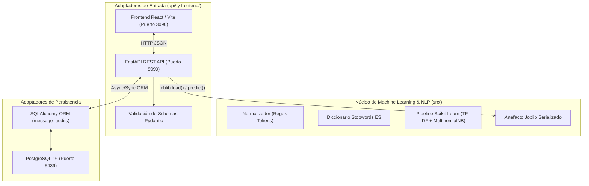

# Arquitectura de Software y Especificación Técnica (ARCHITECTURE.md)

## 1. Patrón Arquitectónico

El sistema aplica principios de **Arquitectura Limpia / Hexagonal (Ports & Adapters)** desacoplando la lógica de Machine Learning de los mecanismos de entrega web (FastAPI) y persistencia (PostgreSQL):

## 2. Aislamiento de Red y Puertos de Docker Compose

| Servicio | Contenedor | Host (Local) | Variable de Entorno | Descripción |
| :--- | :---: | :---: | :--- | :--- |
| **frontend** | `80` | **`3090`** | `VITE_API_URL=http://localhost:8090` | Servidor Nginx con compilado estático de React |
| **api** | `8000` | **`8090`** | `DATABASE_URL=postgresql://user:pass@db:5432/spamdb` | API REST asíncrona FastAPI |
| **db** | `5432` | **`5439`** | `POSTGRES_DB=spamdb` | Motor PostgreSQL con volumen `postgres_data` |

## 3. Modelo de Datos Relacional (PostgreSQL)

### Tabla: `message_audits`

* `id`: `INTEGER PRIMARY KEY GENERATED ALWAYS AS IDENTITY`
* `created_at`: `TIMESTAMP WITH TIME ZONE DEFAULT NOW()`
* `message_text`: `TEXT NOT NULL`
* `prediction`: `VARCHAR(10) NOT NULL` (`ham` o `spam`)
* `probability_spam`: `FLOAT NOT NULL`
* `probability_ham`: `FLOAT NOT NULL`
* `risk_level`: `VARCHAR(15) NOT NULL` (`BAJO`, `MEDIO`, `CRÍTICO`)
* `detected_tokens`: `JSONB` (Lista de tokens clave encontrados como `TOKEN_URL`)
* `user_feedback`: `VARCHAR(10) NULL` (Corrección manual: `true_positive`, `false_positive`)

## 4. Invariantes de Seguridad y Rendimiento

1. **Inferencia en Memoria:** La predicción y el pipeline NLP se ejecutan completamente en memoria RAM del proceso FastAPI (`<5 ms` por mensaje). La base de datos es para auditoría asíncrona y no bloquea el cálculo.
2. **Validación de Entradas:** Textos vacíos, con espacios en blanco o que superen los 2.000 caracteres son rechazados con código HTTP 422 antes de tocar el pipeline de NLP.
3. **Persistencia Transaccional:** Si la conexión a la base de datos se interrumpe, el endpoint de predicción sigue funcionando degradando con gracia el registro de auditoría.
