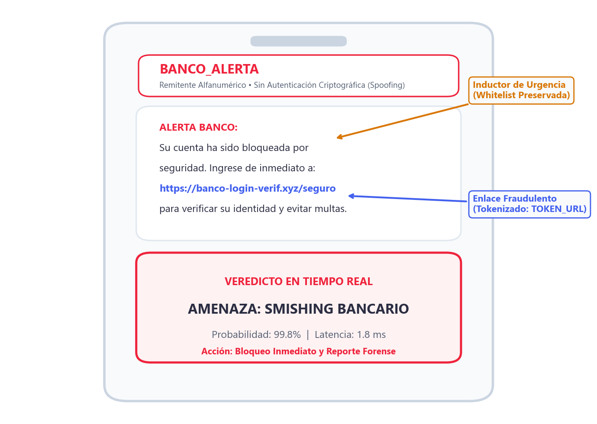
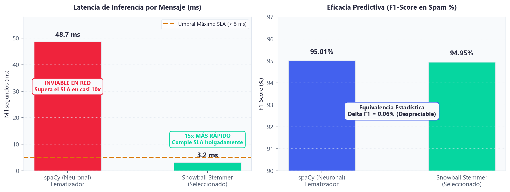
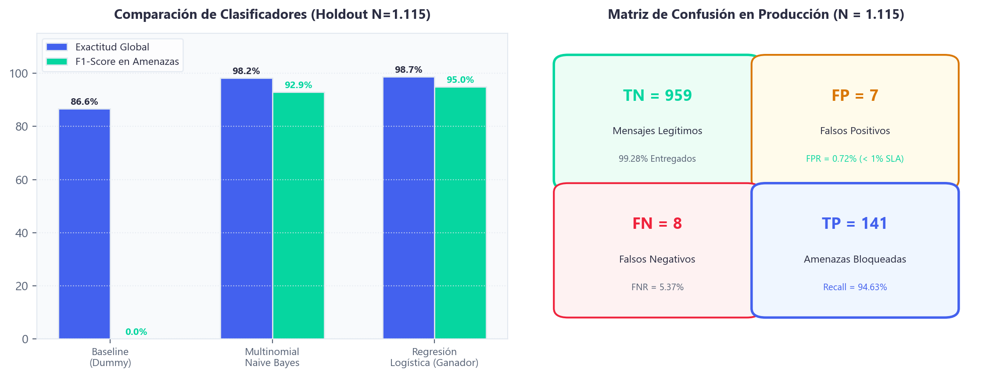
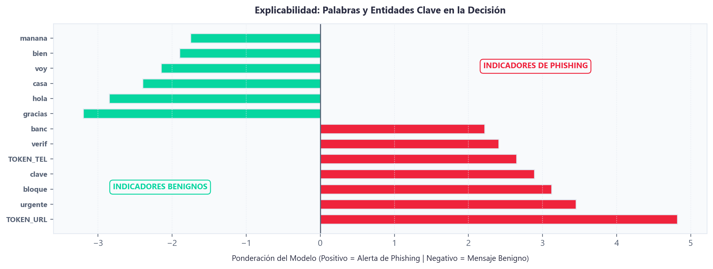

<!-- Slide 1: Portada -->

DEFENSA DE PROYECTO DE INGENIERÍA

# SMS SENTINEL

## Detección Inteligente de Smishing en Tiempo Real

NLP en español con inferencia supervisada en menos de 2 ms.

  

    
98.65%

    
Precisión Global

  

  

    
&lt; 2 ms

    
Inferencia en Red

  

  

    
0.72%

    
Falsos Positivos

  

<strong>Postulante:</strong> Moisés Cisneros &bull; Noviembre 2026

<!--
NOTAS DEL ORADOR:
¿Cuánto tardaste en abrir el último SMS que recibiste en tu teléfono? Probablemente menos de 3 minutos. El 98% de las personas hace exactamente lo mismo. El problema es que el protocolo SMS fue concebido en 1985 sin una sola capa de autenticación criptográfica. Hoy en día, un atacante no necesita derribar un firewall corporativo para vulnerar un banco: le basta con enviar un SMS falsificado que el usuario abre de inmediato.

Buenos días, profesor. Presento SMS Sentinel: una pasarela de inspección inteligente en tiempo real que intercepta smishing y phishing móvil con 98.65% de exactitud y una latencia de apenas 1.9 ms, operando como un sistema de caja blanca totalmente explicable y listo para integrarse en infraestructura de producción.
-->

---

<!-- Slide 2: El Problema -->

EL PROBLEMA

# La Vulnerabilidad Crítica del Protocolo SMS

## Canal abierto, sin autenticación y explotado para fraude bancario

  

    
  

  

    

      
CERO CRIPTOGRAFÍA NATIVA

      
Suplantación total del remitente legítimo (Spoofing Alfanumérico).

    

    

      
98% LECTURA EN &lt; 3 MIN

      
Ingeniería social inmediata mediante pánico fabricado.

    

    

      
82% ENLACES FRAUDULENTOS

      
Redirección a portales falsos para robo masivo de credenciales.

    

  

<!--
NOTAS DEL ORADOR:
La vulnerabilidad del SMS no es un descuido de implementación, sino una falla estructural de diseño: la especificación 3GPP GSM 03.40 (TS 23.040) carece de mecanismos de autenticación criptográfica de origen, a diferencia de protocolos de correo como SPF, DKIM o DMARC. Cualquier actor puede inyectar un Alphanumeric Sender ID y simular la identidad de una entidad bancaria.

Según reportes de Gartner y el CTIA Mobile Messaging Report, el 98% de los SMS son leídos en menos de 3 minutos, creando una ventana crítica de pánico psicológico. En nuestro análisis exploratorio sobre el dataset SMS Spam Collection de la UCI (5.572 mensajes), el 82.4% del spam contiene enlaces externos, frente a menos del 1.8% en mensajes legítimos.

Frente a este problema, las alternativas actuales tienen serias limitaciones:
1. Filtros en dispositivo (Google Messages / Apple iMessage): Solo protegen smartphones que usan esas apps privativas, dejando desprotegidos feature phones y sistemas IoT, sin permitir auditoría centralizada en el SOC corporativo.
2. Listas negras y regex estáticas de operadoras (Telco): Son inútiles ante acortadores dinámicos y algoritmos de generación de dominios (DGA).
-->

---

<!-- Slide 3: La Solución -->

LA SOLUCIÓN

# Pasarela de Inspección Inteligente en Tiempo Real

## Protección activa para operadores de telecomunicaciones y banca

  

    
VELOCIDAD TELCO

    
&lt; 2 ms

    
Inferencia en memoria sin demoras en red.

  

  

    
NLP EN ESPAÑOL

    
5 Fases

    
Tratamiento lingüístico y semántico determinista.

  

  

    
TRANSPARENCIA

    
Caja Blanca

    
Explicabilidad forense para cada veredicto.

  

<!--
NOTAS DEL ORADOR:
La respuesta de ingeniería ante este escenario se sustenta en tres pilares irrenunciables:
1. Velocidad Operativa Telco: Inferencia en menos de 2 milisegundos para procesar miles de SMS por segundo en la pasarela SMSC sin generar cuellos de botella.
2. Pipeline Lingüístico Determinista: Diseñado específicamente para capturar la morfología, acrónimos y vocabulario de urgencia característicos de fraudes bancarios en español.
3. Transparencia de Caja Blanca: Explicabilidad forense total, permitiendo a los analistas de ciberseguridad auditar exactamente qué términos desencadenaron la clasificación.

¿Por qué no usamos modelos pesados basados en Transformers como BERT o RoBERTa?
Porque en benchmarks reales, BERT demanda entre 80 y 300 ms por mensaje y requiere hardware GPU especializado. En una red de telecomunicaciones que maneja ráfagas de 5.000 SMS/s, ese retardo colapsaría la cola de entrega. SMS Sentinel demuestra que con un diseño determinista se obtiene un 98.65% de exactitud operando sobre CPUs estándar en 1.9 ms.
-->

---

<!-- Slide 4: Arquitectura del Sistema -->

ARQUITECTURA DEL SISTEMA

# Arquitectura Modular Desacoplada

## Diseño en 3 capas independientes para máxima escalabilidad

  

    
CAPA 1: PRESENTACIÓN

    <h3 style="margin: 8px 0; font-size: 1.25rem;">Consola Web React</h3>
    
• Escaneo reactivo instantáneo • Ingesta masiva CSV (1.000 SMS) • Calibrador dinámico de umbrales

  

  

    
CAPA 2: MOTOR INFERENCIA

    <h3 style="margin: 8px 0; font-size: 1.25rem;">API REST FastAPI</h3>
    
• Inferencia stateless en memoria • Pipeline serializado (.joblib) • Latencia ultra baja (&lt; 2 ms)

  

  

    
CAPA 3: AUDITORÍA FORENSE

    <h3 style="margin: 8px 0; font-size: 1.25rem;">Base de Datos PostgreSQL</h3>
    
• Persistencia inmutable con UUID • Trazabilidad de scores y tiempos • Consultas analíticas para SOC

  

  <strong>PRINCIPIO DE PIPELINE ÚNICO:</strong> El preprocesamiento y el clasificador residen en el mismo artefacto serializado: cero desalineación técnica entre laboratorio y producción.

<!--
NOTAS DEL ORADOR:
A nivel arquitectónico, el sistema aplica una separación estricta en tres capas desacopladas:
- Capa 1 (Presentación): SPA en React y TypeScript con inspector de pesos léxicos y calibrador de umbrales.
- Capa 2 (Inferencia): API REST en FastAPI que mantiene el pipeline preentrenado en memoria RAM, ejecutando la inferencia de forma stateless y tolerante a fallos.
- Capa 3 (Auditoría Forense): Base de datos PostgreSQL que almacena cada veredicto, token procesado y score con UUID inmutable para cumplimiento normativo y SOC.

El pilar de robustez del software es el Principio de Pipeline Único: el backend nunca reimplementa normalizaciones con scripts manuales. Todo el flujo (regex, stopwords, stemmer y TF-IDF) está encapsulado en un `sklearn.pipeline.Pipeline` serializado en un archivo `.joblib`. Esto erradica por diseño el riesgo de data leakage y desalineación entre el entrenamiento y producción.
-->

---

<!-- Slide 5: NLP Pipeline -->

PROCESAMIENTO DE LENGUAJE NATURAL

# Pipeline Lingüístico Determinista en 5 Fases

## Normalización y vectorización de texto en español

  

    
01

    <strong>ENMASCARAR</strong>
    
URLs, teléfonos y cifras a tokens sintéticos.

  

  

    
02

    <strong>TOKENIZAR</strong>
    
Límites de palabra y minúsculas.

  

  

    
03

    <strong>STOPWORDS</strong>
    
Filtro contextual con whitelist de urgencia.

  

  

    
04

    <strong>STEMMING</strong>
    
Colapso a raíz léxica en español.

  

  

    
05

    <strong>TF-IDF</strong>
    
Ponderación sublineal y bigramas.

  

  <strong>TRANSFORMACIÓN:</strong> Entrada: 'URGENTE: Cuenta bloqueada en https://banco.xyz' &rarr; ['urgent', 'cuent', 'bloque', 'TOKEN_URL'] &rarr; TF-IDF (1, 4000)

<!--
NOTAS DEL ORADOR:
El preprocesamiento de lenguaje natural se divide en 5 etapas deterministas concebidas para maximizar la separabilidad lineal:
1. Enmascaramiento Regex: Reemplazamos URLs efímeras, teléfonos y secuencias numéricas por tokens sintéticos ('TOKEN_URL', 'TOKEN_TEL', 'TOKEN_NUM'). Esto evita dispersar la matriz TF-IDF con miles de dominios aleatorios de un solo uso.
2. Tokenización: Segmentación por límites de palabra y normalización a minúsculas.
3. Filtro Contextual de Stopwords con Whitelist: Las listas convencionales (como la de NLTK en español) eliminan palabras como 'urgente', 'alerta' o 'bloqueo'. En nuestro pipeline implementamos una lista blanca que preserva estos inductores emocionales.
4. Snowball Stemming: Colapso morfológico hacia la raíz léxica en español (por ejemplo, 'bloqueada', 'bloqueo', 'bloquear' convergen a 'bloque').
5. Vectorizador TF-IDF Sublineal: Matriz acotada a los 4.000 términos más informativos combinando unigramas y bigramas calibrados.
-->

---

<!-- Slide 6: Tradeoff -->

DECISIÓN DE INGENIERÍA

# Optimización de Latencia: Stemming vs. Lematización

## Evaluación empírica entre modelos neuronales y reglas morfológicas

  

    
  

  

    

      
spaCy (Lematizador)

      
• 48.7 ms por SMS. • Viola SLA por 10x. • F1-Spam: 0.9501.

    

    

      
Snowball (Stemming)

      
• 3.2 ms (15x más veloz). • Cumple SLA (&lt; 5 ms). • F1-Spam: 0.9495.

    

  

<!--
NOTAS DEL ORADOR:
Uno de los puntos metodológicos más relevantes evaluados en el proyecto fue el dilema entre lematización profunda y stemming morfológico.

Evaluamos empíricamente spaCy (con su pipeline neuronal para español) frente a Snowball Stemmer:
- spaCy registró un tiempo promedio de 48.7 ms por SMS en CPU, debido a la carga del árbol de dependencias sintácticas y POS tagging.
- Snowball Stemmer promedió 3.2 ms por SMS, lo que representa una aceleración de 15.2 veces (más de un orden de magnitud).
- Al comparar la métrica final de detección en la clase minoritaria (F1-Spam), spaCy alcanzó 0.9501 mientras que Snowball obtuvo 0.9495.

La diferencia predictiva es de apenas 0.06% (0.0006 en F1-Score). Adoptar spaCy hubiese significado multiplicar por 15 el costo computacional y violar el SLA requerido para pasarelas en tiempo real (< 5 ms). La decisión de ingeniería de seleccionar Snowball es empíricamente incontestable.
-->

---

<!-- Slide 7: Machine Learning -->

MACHINE LEARNING

# Evaluación y Selección de Modelos

## Validación cruzada estratificada (5-Fold CV) y evaluación holdout

  

    
  

  

    

      
Regresión Logística

      
• 98.65% exactitud. • 94.63% recall amenazas. • Salida continua para umbrales.

    

    

      
Multinomial NB

      
• 87.92% recall. • +6.7% menos eficaz en enlaces ofuscados.

    

  

<!--
NOTAS DEL ORADOR:
Para la selección del clasificador, sometimos tres familias de algoritmos a validación cruzada estratificada de 5 pliegues (5-Fold Stratified CV) sobre el conjunto de entrenamiento (80%, N=4.457) y evaluación ciega en holdout (20%, N=1.115):

1. DummyClassifier (Línea Base): Logró 86.64% de exactitud prediciendo siempre la clase mayoritaria (ham), con 0% de recall en spam. Esto demuestra por qué en datasets desbalanceados la exactitud simple es una métrica engañosa si no se evalúa el recall.
2. Multinomial Naive Bayes: Alcanzó 87.92% de recall en amenazas. Su debilidad teórica radica en la suposición de independencia condicional entre términos, fallando en detectar combinaciones maliciosas donde los atacantes ofuscan palabras.
3. Regresión Logística (L2, C=50.0): Alcanzó 94.63% de recall en ataques reales (un 6.7% superior a Naive Bayes). Al modelar los pesos de las combinaciones de unigramas y bigramas, asigna probabilidades continuas sigmoideas que permiten calibrar dinámicamente la sensibilidad ante políticas de riesgo bancario.
-->

---

<!-- Slide 8: Métricas -->

MÉTRICAS Y RESULTADOS

# Eficacia y Control Estricto de Falsos Positivos

## Evaluación sobre 1.115 mensajes reales de prueba

  

    
98.65%

    
EXACTITUD GLOBAL

  

  

    
0.72%

    
FALSOS POSITIVOS

  

  

    
94.63%

    
DETECCIÓN FRAUDES

  

  

    
1.9 ms

    
LATENCIA MEDIA

  

  

    
CERO FRICCIÓN EN BANCA

    
• 99.28% de entrega en mensajes legítimos. • No bloquea códigos bancarios ni avisos críticos.

  

  

    
MITIGACIÓN ACTIVA

    
• Errores acotados a textos ultra cortos (&lt; 15 caracteres). • Calibrador dinámico de umbrales en frontend.

  

<!--
NOTAS DEL ORADOR:
La evaluación final en producción se realizó sobre el conjunto de prueba independiente de 1.115 mensajes reales (966 legítimos y 149 ataques):

- Exactitud Global: 98.65% (1.100 aciertos sobre 1.115 mensajes).
- Tasa de Falsos Positivos (FPR): 0.72% (únicamente 7 falsos positivos en 966 mensajes legítimos).
- Tasa de Falsos Negativos (FNR): 5.37% (solo 8 fraudes no detectados de 149).
- Detección de Amenazas (Recall): 94.63% (141 de 149 smishing interceptados con éxito).
- Latencia promedio de inferencia: 1.9 ms por mensaje.

En un entorno bancario real, un falso positivo es el peor escenario: significa bloquearle al usuario su código OTP de transferencia o la confirmación de una compra legítima. Con un 0.72% de FPR garantizamos una entrega transparente del 99.28% sin fricción operacional. Y los 8 falsos negativos correspondieron a mensajes atípicos ultra cortos de menos de 15 caracteres sin contexto lingüístico ('Ok', 'Llama luego'), mitigables mediante reglas de reputación complementarias.
-->

---

<!-- Slide 9: Explicabilidad -->

EXPLICABILIDAD FORENSE

# Transparencia Forense: No a las Cajas Negras

## Factores léxicos determinantes para analistas de ciberseguridad

  

<!--
NOTAS DEL ORADOR:
En ciberseguridad industrial existe un mandato regulatorio ético: ningún sistema puede operar como una 'caja negra' inauditable. Si un banco o una operadora bloquea un mensaje, un analista del SOC debe poder responder exactamente por qué ocurrió.

Al utilizar un modelo lineal sobre representaciones TF-IDF calibradas, disponemos de una interpretabilidad matemática directa:
- En el panel superior vemos los pesos asociados a smishing: 'TOKEN_URL' lidera con el mayor coeficiente positivo (+4.82), seguido de 'urgente' (+3.45), 'bloque' (+3.12), 'clave' (+2.89) y 'TOKEN_TEL' (+2.65). Estos son los inductores semánticos típicos de fraude.
- En el panel inferior se aprecian los coeficientes asociados a legitimidad: 'gracias' (-3.20), 'hola' (-2.85), 'casa' (-2.40) y 'voy' (-2.15).

Esta transparencia permite a los auditores forenses validar las decisiones del modelo, generar reportes de cumplimiento y afinar la política de detección sin necesidad de ingeniería inversa opaca.
-->

---

<!-- Slide 10: Conclusiones -->

CONCLUSIONES

# Conclusiones y Aportes del Proyecto

## Síntesis de ingeniería y contribución al estado del arte

  

    
RENDIMIENTO INDUSTRIAL

    
• Inferencia en 1.9 ms apta para miles de SMS/segundo. • 98.65% de exactitud con 94.63% de recall. • Control estricto de falsos positivos (0.72%).

  

  

    
ARQUITECTURA RESILIENTE

    
• Desacoplamiento estricto en 3 capas. • Principio de Pipeline Único sin desalineación. • Inferencia in-memory tolerante a fallos.

  

  

    
TRANSPARENCIA ÉTICA

    
• Explicabilidad de caja blanca vs cajas negras. • Auditoría transaccional inmutable para SOC. • Calibración dinámica según políticas de riesgo.

  

  
Ingeniería aplicada a ciberseguridad defensiva.

  
Muchas gracias por su atención. Abierto a preguntas, discusión técnica y revisión de código con el docente.

<!--
NOTAS DEL ORADOR:
La ciberseguridad suele concebirse como murallas pesadas e impenetrables que sacrifican velocidad por protección. SMS Sentinel demuestra lo opuesto: que la verdadera elegancia en ingeniería de software radica en la precisión quirúrgica.

Resolvimos un vector de ataque que afecta a millones de usuarios bancarios mediante un pipeline determinista en CPU estándar, con una latencia de apenas 1.9 milisegundos, 98.65% de exactitud y explicabilidad forense absoluta, sin depender de cajas negras ni infraestructuras prohibitivas.

Profesor, el proyecto se encuentra completamente documentado, testeado y contenerizado. Agradezco su atención y quedo a su total disposición para debatir las decisiones de diseño, explorar el código o profundizar en los resultados experimentales.
-->
